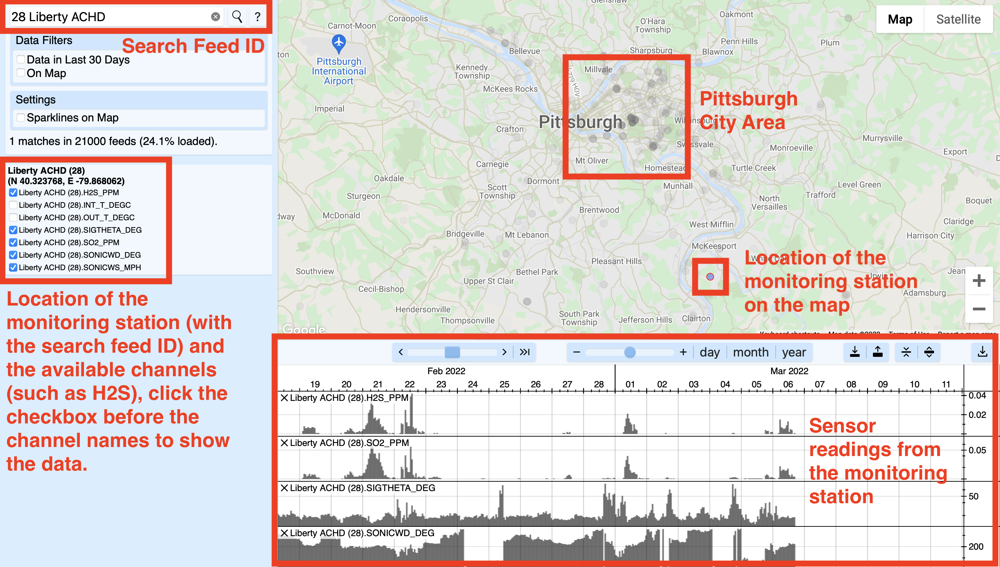

# smell-pittsburgh-dataset-v2.1

Smell Pittsburgh is a web-based application that crowdsources smell reports so we all can better track how odors from pollutants travel through the air across the Pittsburgh region. More information is on the [Smell Pittsburgh website](https://smellpgh.org).

This is the second version (v2.1, having more data than the v2 version) of the Smell Pittsburgh dataset from **10/31/2016** (month/day/year) to **12/11/2022** (month/day/year), including the following zipcodes in the Pittsburgh region in Pennsylvania, USA:

- 15006, 15007, 15014, 15015, 15017, 15018, 15020, 15024, 15025, 15028, 15030, 15031, 15032, 15034, 15035, 15037, 15044, 15045, 15046, 15047, 15049, 15051, 15056, 15064, 15065, 15071, 15075, 15076, 15082, 15084, 15086, 15088, 15090, 15091, 15095, 15096, 15101, 15102, 15104, 15106, 15108, 15110, 15112, 15116, 15120, 15122, 15123, 15126, 15127, 15129, 15131, 15132, 15133, 15134, 15135, 15136, 15137, 15139, 15140, 15142, 15143, 15144, 15145, 15146, 15147, 15148, 15201, 15202, 15203, 15204, 15205, 15206, 15207, 15208, 15209, 15210, 15211, 15212, 15213, 15214, 15215, 15216, 15217, 15218, 15219, 15220, 15221, 15222, 15223, 15224, 15225, 15226, 15227, 15228, 15229, 15230, 15231, 15232, 15233, 15234, 15235, 15236, 15237, 15238, 15239, 15240, 15241, 15242, 15243, 15244, 15250, 15251, 15252, 15253, 15254, 15255, 15257, 15258, 15259, 15260, 15261, 15262, 15264, 15265, 15267, 15268, 15270, 15272, 15274, 15275, 15276, 15277, 15278, 15279, 15281, 15282, 15283, 15286, 15289, 15290, 15295

This dataset is released under the Creative Commons Zero (CC0) license. Please feel free to use this dataset for your own research. If you found this dataset and the code useful, we would greatly appreciate it if you could cite our paper below.

Yen-Chia Hsu, Jennifer Cross, Paul Dille, Michael Tasota, Beatrice Dias, Randy Sargent, Ting-Hao (Kenneth) Huang, and Illah Nourbakhsh. 2020. Smell Pittsburgh: Engaging Community Citizen Science for Air Quality. ACM Transactions on Interactive Intelligent Systems. 10, 4, Article 32. DOI:https://doi.org/10.1145/3369397. Preprint:https://arxiv.org/pdf/1912.11936.pdf.

One thing to keep in mind is that the above paper only uses a part of the zipcodes, listing below:

- 15221, 15218, 15222, 15219, 15201, 15224, 15213, 15232, 15206, 15208, 15217, 15207, 15260, 15104

A similar previous version [v1 dataset](/dataset/v1) (with a smaller number of zipcodes and time range) was used for the data analysis in the above paper. This version v2 dataset has not been analyzed and remains an open challenge.

Below are descriptions about what each column means in the file that contains smell reports (the "smell_raw.csv"):
- EpochTime: the Epoch timestamp when the smell is experienced
- skewed_latitude: the skewed latitude of the location where the smell is experienced
- skewed_longitude: the skewed longitude of the location where the smell is experienced
- smell_value: the self-reported rating of the smell (described on the [Smell Pittsburgh website](https://smellpgh.org/how_it_works))
- smell_description: the self-reported description of the smell (e.g., woodsmoke)
- feelings_symptoms: the self-reported symptoms that may caused by the source of the smell (e.g., eye irritation)
- additional_comments: the self-provided comment to the agency that receives the smell report
- zipcode: the zipcode of the location where the smell is experienced

Information about the metadata (e.g., latitude, longitude, feed ID, channel name) of the sensor monitoring stations used in this dataset (all files in the "esdr_raw" folder) can be found on the [ESDR data visualization page](https://environmentaldata.org/#time=1642345888.849,1642950688.849&cursor=1642730480.675&plotHeight=5.000&plotAreaHeight=40.000&showFilters=true&showSettings=true&showResults=true&center=40.445982705178,-79.96401491796037&zoom=12). ESDR means the [Environmental Sensor Data Repository](https://esdr.cmucreatelab.org/), a service for hosting environmental data. The feed ID and the channel name in the [code for gettting the sensor data](/py/prediction/getData.py) corresponds to the metadata on the visualization page. More description about the sensor data is in the next section.

## Description of the air quality sensor data
The files in the "esdr_raw" folder contains tables of air quality data from multiple monitoring stations. Every air quality monitoring station has a unique feed ID. Some stations are operated by the municipality (which is ACHD, the Allegany County Health Department), and some of them are operated by local citizens. Every feed has several channels, for example, H2S. To find the metadata of an air quality monitoring station, go to the following website to search using the feed ID.

- Environmental Data Website: [https://environmentaldata.org/](https://environmentaldata.org/)

The above-mentioned website is a service that collects and visualizes environmental sensor measurements. The following screenshot shows the search result of feed ID 28, which is a monitoring station south of Pittsburgh. This monitoring station is near a major pollution source, which is the Clairton Mill Works which belongs to the United States Steel Corporation. The raw data from the monitoring station is regularly published by the ACHD.

The following list shows the URL with metadata for available air quality and weather variables in the dataset. The variable names (i.e., column names) are provided under the corresponding feed. Notice that some monitoring stations were replaced by others at some time point, so some variables in the dataset represent the combination of multiple channels or feeds, which is explained in the comments in the [Python script for getting data](/py/prediction/getData.py). Here is a [link to the locations of all the sensor stations](https://esdr.cmucreatelab.org/api/v1/feeds?fields=id,name,latitude,longitude&whereOr=id=26,id=59665,id=28,id=23,id=43,id=11067,id=1,id=27,id=29,id=3,id=3506,id=5975,id=3508,id=24) that are listed below. An archived location metadata can be found in the [esdr_metadata.json](/dataset/v2/esdr_metadata.json) file.

- [Feed 26: Lawrenceville ACHD](https://environmentaldata.org/#channels=26.OZONE_PPM,26.SONICWD_DEG,26.SONICWS_MPH,26.SIGTHETA_DEG&time=1332026105.840,1796646572.308&plotHeight=5.000&plotAreaHeight=40.000&showFilters=true&showSettings=true&showResults=true&center=40.40529301325395,-79.93830235610686&zoom=11&search=26+Lawrenceville+ACHD)
  - 3.feed_26.OZONE_PPM
  - 3.feed_26.SONICWS_MPH
  - 3.feed_26.SONICWD_DEG
  - 3.feed_26.SIGTHETA_DEG
  - (Important: the SONICWS_MPH, SONICWD_DEG, and SIGTHETA_DEG data are only up to early 2023)
- Combination of the variables from ["Feed 26: Lawrenceville ACHD" and "Feed 59665: Pittsburgh ACHD"](https://environmentaldata.org/#channels=26.PM25T_UG_M3,26.PM25B_UG_M3,26.PM10B_UG_M3,59665.PM10_640_UG_M3,59665.PM25_640_UG_M3&time=1403410547.849,1797388664.517&plotHeight=5.000&plotAreaHeight=40.000&showFilters=true&showSettings=true&showResults=true&center=40.444856858961735,-79.91911821671611&zoom=12&search=26)
  - 3.feed_26.PM25B_UG_M3..3.feed_26.PM25T_UG_M3..3.feed_59665.PM25_640_UG_M3
  - 3.feed_26.PM10B_UG_M3..3.feed_59665.PM10_640_UG_M3
  - (Important: there is a gap in the PM10 data from mid-2020 to the end of 2020)
- [Feed 28: Liberty ACHD](https://environmentaldata.org/#channels=28.H2S_PPM,28.SO2_PPM,28.SIGTHETA_DEG,28.SONICWD_DEG,28.SONICWS_MPH&time=1327915448.720,1797182119.877&plotHeight=5.000&plotAreaHeight=40.000&showFilters=true&showSettings=true&showResults=true&center=40.40529301325395,-79.93830235610686&zoom=11&search=28+Liberty+ACHD)
  - 3.feed_28.H2S_PPM
  - 3.feed_28.SO2_PPM
  - 3.feed_28.SIGTHETA_DEG
  - 3.feed_28.SONICWD_DEG
  - 3.feed_28.SONICWS_MPH
  - (Important: SIGTHETA_DEG readings are only up to early 2023)
- [Feed 23: Flag Plaza ACHD](https://environmentaldata.org/#channels=23.CO_PPM,23.CO_PPB,23.PM10_UG_M3&time=1336733118.425,1700024524.753&plotHeight=5.000&plotAreaHeight=40.000&showFilters=true&showSettings=true&showResults=true&center=40.40529301325395,-79.93830235610686&zoom=11&search=23+Flag+Plaza+ACHD)
  - 3.feed_23.CO_PPM..3.feed_23.CO_PPB
  - 3.feed_23.PM10_UG_M3
  - (Important: the CO readings are only up to late 2020, and the PM10 readings are only up to early 2022)
- First combination of the variables from ["Feed 43: Parkway East ACHD" and "Feed 11067: Parkway East Near Road ACHD"](https://environmentaldata.org/#channels=43.CO_PPB,43.SONICWD_DEG,43.SIGTHETA_DEG,43.SONICWS_MPH,11067.CO_PPB,11067.SIGTHETA_DEG,11067.SONICWD_DEG,11067.SONICWS_MPH&time=1381187827.392,1798051563.253&plotHeight=5.000&plotAreaHeight=60.000&showFilters=true&showSettings=true&showResults=true&center=40.446586731639975,-79.92594273696623&zoom=11&search=11067)
  - 3.feed_43.CO_PPB..3.feed_11067.CO_PPB
  - 3.feed_43.SIGTHETA_DEG..3.feed_11067.SIGTHETA_DEG
  - 3.feed_43.SONICWD_DEG..3.feed_11067.SONICWD_DEG
  - 3.feed_43.SONICWS_MPH..3.feed_11067.SONICWS_MPH
  - (Important: the SIGTHETA_DEG reading is only up to mid-2023)
- Second combination of the variables from ["Feed 43: Parkway East ACHD" and "Feed 11067: Parkway East Near Road ACHD"](https://environmentaldata.org/#channels=11067.NO2_200_PPB,11067.NO2_PPB,43.NO2_PPB,11067.NO_200_PPB,11067.NO_PPB,43.NO_PPB,11067.NOx_200_PPB,11067.NOX_PPB,43.NOX_PPB,11067.PM25_640_UG_M3,11067.PM25T_UG_M3,43.PM25T_UG_M3&time=1369222366.779,1809134577.556&plotHeight=5.000&plotAreaHeight=80.000&showFilters=true&showSettings=true&showResults=true&center=40.446586731639975,-79.92594273696623&zoom=11&search=43)
  - 3.feed_43.PM25T_UG_M3..3.feed_11067.PM25T_UG_M3..3.feed_11067.PM25_640_UG_M3
  - 3.feed_43.NO2_PPB..3.feed_11067.NO2_PPB..3.feed_11067.NO2_200_PPB
  - 3.feed_43.NOX_PPB..3.feed_11067.NOX_PPB..3.feed_11067.NOx_200_PPB
  - 3.feed_43.NO_PPB..3.feed_11067.NO_PPB..3.feed_11067.NO_200_PPB
  - (Important: the NO_PPB and NOX_PPB readings are not reliable from late-2022 to mid-2024, as shown in the graph in the ESDR link)
- [Feed 1: Avalon ACHD](https://environmentaldata.org/#channels=1.H2S_PPM,1.PM25B_UG_M3,1.PM25T_UG_M3,1.SO2_PPM,1.SONICWD_DEG,1.SONICWS_MPH,1.SIGTHETA_DEG,1.PM25_640_UG_M3&time=1311961737.581,1806476263.231&plotHeight=5.000&plotAreaHeight=60.000&showFilters=true&showSettings=true&showResults=true&center=40.474829304242206,-79.99010733661984&zoom=12&search=1+Avalon+ACHD)
  - 3.feed_1.PM25B_UG_M3..3.feed_1.PM25T_UG_M3..3.feed_1.PM25_640_UG_M3
  - 3.feed_1.SO2_PPM
  - 3.feed_1.H2S_PPM
  - 3.feed_1.SIGTHETA_DEG
  - 3.feed_1.SONICWD_DEG
  - 3.feed_1.SONICWS_MPH
  - (Important: H2S and SO2 data are only up to late 2020, and wind data are only up to early 2020)
- [Feed 27: Lawrenceville 2 ACHD](https://environmentaldata.org/#channels=27.NO_PPB,27.NOY_PPB,27.CO_PPB,27.SO2_PPB&time=1303976430.765,1803436101.673&plotHeight=5.000&plotAreaHeight=40.000&showFilters=true&showSettings=true&showResults=true&center=40.45507754882611,-79.94980366836272&zoom=12&search=27+Lawrenceville+2+ACHD)
  - 3.feed_27.NO_PPB
  - 3.feed_27.NOY_PPB
  - 3.feed_27.CO_PPB
  - 3.feed_27.SO2_PPB
  - (Important: NO and NOY are only up to early 2023)
- [Feed 29: Liberty 2 ACHD](https://environmentaldata.org/#channels=29.PM10_UG_M3,29.PM25T_UG_M3,29.PM25_UG_M3,29.PM10_640_UG_M3,29.PM25_640_UG_M3&time=1301910026.945,1811408837.239&plotHeight=5.000&plotAreaHeight=40.000&showFilters=true&showSettings=true&showResults=true&center=40.40529301325395,-79.93830235610686&zoom=11&search=29+Liberty+2+ACHD)
  - 3.feed_29.PM10_UG_M3..3.feed_29.PM10_640_UG_M3
  - 3.feed_29.PM25_UG_M3..3.feed_29.PM25T_UG_M3..3.feed_29.PM25_640_UG_M3
- [Feed 3: North Braddock ACHD](https://environmentaldata.org/#channels=3.SO2_PPM,3.SONICWD_DEG,3.SONICWS_MPH,3.SIGTHETA_DEG,3.PM10B_UG_M3,3.PM10_640_UG_M3&time=1307506029.390,1797124371.619&cursor=1375230231.985&plotHeight=5.000&plotAreaHeight=60.000&showFilters=true&showSettings=true&showResults=true&center=40.40529301325395,-79.93830235610686&zoom=11&search=3+North+Braddock+ACHD)
  - 3.feed_3.SO2_PPM
  - 3.feed_3.SONICWD_DEG
  - 3.feed_3.SONICWS_MPH
  - 3.feed_3.SIGTHETA_DEG
  - 3.feed_3.PM10B_UG_M3..3.feed_3.PM10_640_UG_M3
  - (Important: the SIGTHETA_DEG readings are up to early 2023)
- [Feed 3506: BAPC 301 39TH STREET BLDG AirNow](https://environmentaldata.org/#channels=3506.PM2_5,3506.OZONE&time=1313229293.223,1807743818.875&cursor=1578110397.648&plotHeight=5.000&plotAreaHeight=40.000&showFilters=true&showSettings=true&showResults=true&center=40.40529301325395,-79.93830235610686&zoom=11&search=3506+BAPC+301+39TH+STREET+BLDG+AirNow)
  - 3.feed_3506.PM2_5
  - 3.feed_3506.OZONE
- [Feed 5975: Parkway East AirNow](https://environmentaldata.org/#channels=5975.PM2_5&time=1417681087.892,1791947270.013&cursor=1645885732.459&plotHeight=5.000&plotAreaHeight=40.000&showFilters=true&showSettings=true&showResults=true&center=40.40529301325395,-79.93830235610686&zoom=11&search=5975+Parkway+East+AirNow)
  - 3.feed_5975.PM2_5
- [Feed 3508: South Allegheny High School AirNow](https://environmentaldata.org/#channels=3508.PM2_5&time=1323077027.590,1817591553.242&cursor=1574347640.483&plotHeight=5.000&plotAreaHeight=40.000&showFilters=true&showSettings=true&showResults=true&center=40.40529301325395,-79.93830235610686&zoom=11&search=3508+South+Allegheny+High+School+AirNow)
  - 3.feed_3508.PM2_5
- [Feed 24: Glassport High Street ACHD](https://environmentaldata.org/#channels=24.PM10_UG_M3&time=1308012124.761,1802526650.413&cursor=1514282859.695&plotHeight=5.000&plotAreaHeight=40.000&showFilters=true&showSettings=true&showResults=true&center=40.40529301325395,-79.93830235610686&zoom=11&search=24+Glassport+High+Street+ACHD)
  - 3.feed_24.PM10_UG_M3
- [Feed 26086: Clairton ACHD](https://environmentaldata.org/#channels=26086.PAMB_640_KPa,26086.TAMB_640_DEGC,26086.PM25_640_UG_M3&time=1637356636.608,1785721644.594&plotHeight=5.000&plotAreaHeight=40.000&showFilters=true&showSettings=true&showResults=true&center=40.403410329993896,-79.89735489363282&zoom=11&search=26086)
  - 3.feed_26086.PAMB_640_KPa
  - 3.feed_26086.PM25_640_UG_M3
  - 3.feed_26086.TAMB_640_DEGC

Below are explanations about the [suffix of the variable names](../v2/Acronyms_for_the_Daily_Summary_Report.pdf) in the above list. There is also an [online documentation of the air quality data](https://tools.wprdc.org/pages/air-quality-docs.html).

- SO2_PPM: sulfur dioxide in ppm (parts per million)
- SO2_PPB: sulfur dioxide in ppb (parts per billion)
- H2S_PPM: hydrogen sulfide in ppm
- SIGTHETA_DEG: standard deviation of the wind direction
- SONICWD_DEG: wind direction (the direction from which it originates) in degrees
- SONICWS_MPH: wind speed in mph (miles per hour)
- CO_PPM: carbon monoxide in ppm
- CO_PPB: carbon monoxide in ppb
- PM10_UG_M3: particulate matter (PM10) in micrograms per cubic meter
- PM10B_UG_M3: same as PM10_UG_M3
- PM25_UG_M3: fine particulate matter (PM2.5) in micrograms per cubic meter
- PM25T_UG_M3: same as PM25_UG_M3
- PM25_640_UG_M3: same as PM25_UG_M3
- PM2_5: same as PM25_UG_M3
- PM25B_UG_M3: same as PM25_UG_M3
- NO_PPB: nitric oxide in ppb
- NO2_PPB: nitrogen dioxide in ppb
- NOX_PPB: sum of of NO and NO2 in ppb 
- NOY_PPB: sum of all oxidized atmospheric odd-nitrogen species in ppb
- OZONE_PPM: ozone (or trioxygen) in ppm
- OZONE: same as OZONE_PPM
- PAMB_640_KPa: Ambient pressure in KPa
- TAMB_640_DEGC: Ambient temperature in degrees Celsius